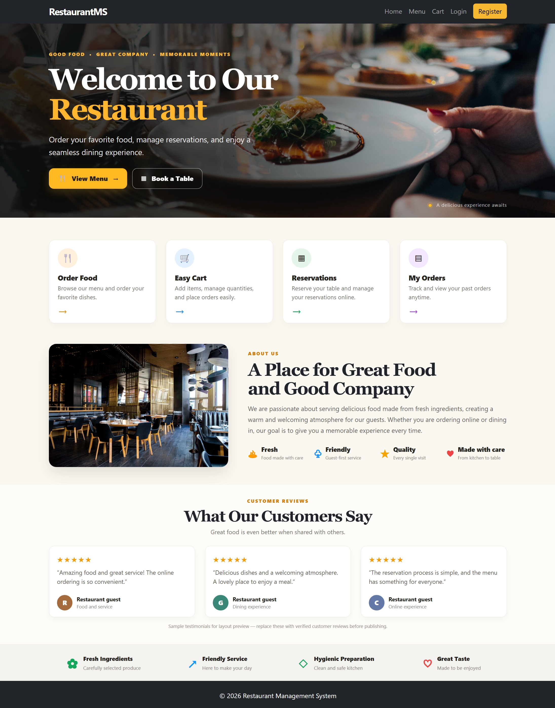
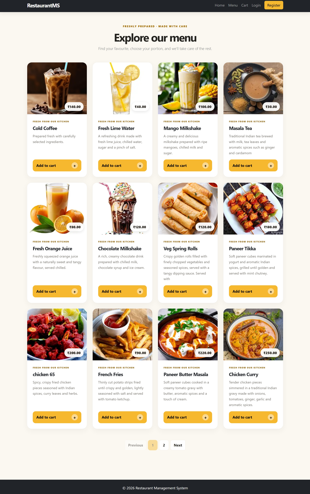
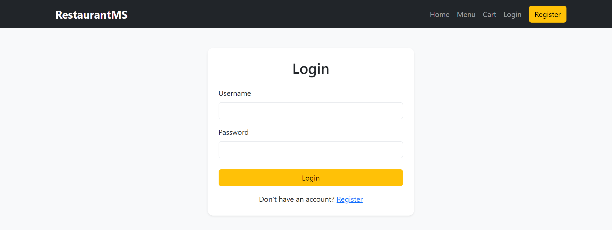
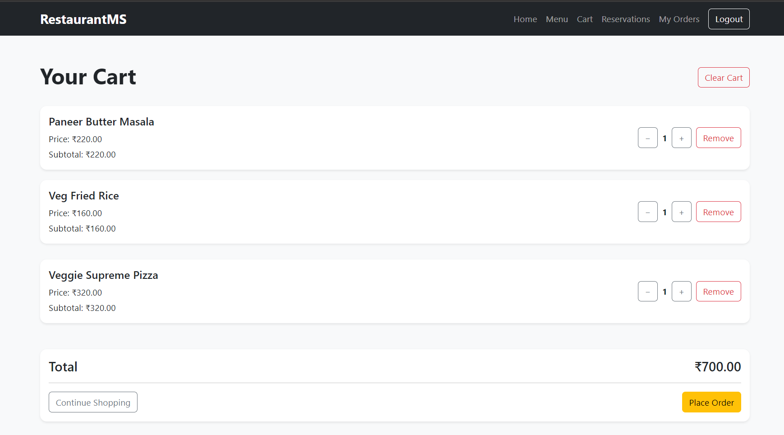
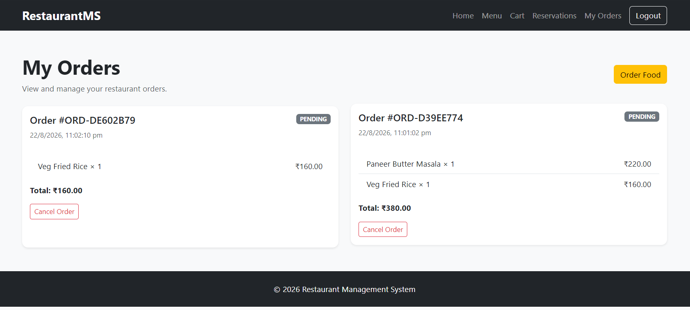
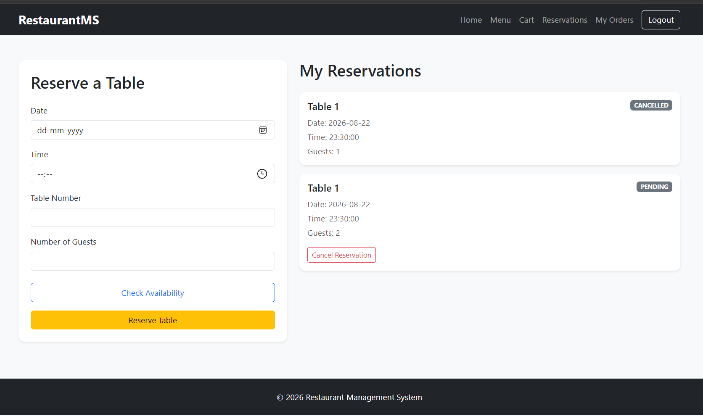
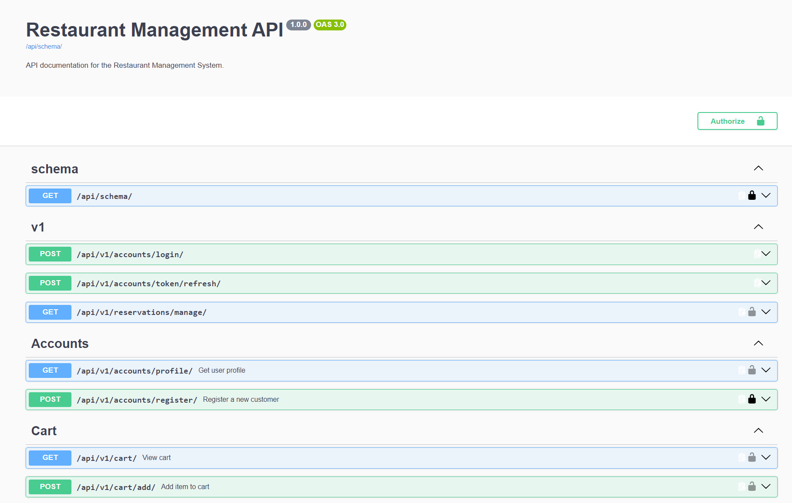

# 🍽️ Restaurant Management System

A full-stack **Restaurant Management System** built with **Django** and **Django REST Framework**. The application provides customer-facing functionality and REST APIs for managing restaurant operations, including user authentication, menu browsing, cart management, orders, payments, and table reservations.

The project includes **JWT authentication**, **Swagger/OpenAPI documentation**, **MySQL configuration using environment variables**, and production deployment configuration using **Gunicorn**, **WhiteNoise**, and **Railway**.

---

## 🚀 Features

### 👤 Authentication & User Management

* User registration and login
* JWT-based authentication for API access
* Protected endpoints for authenticated users
* Staff and admin access for management operations

### 🍔 Menu Management

* Public menu browsing
* View available menu items
* Menu management functionality

### 🛒 Cart Management

* Add items to the cart
* Update item quantities
* Remove items from the cart
* Manage authenticated user carts

### 📦 Order Management

* Create customer orders
* Cash-on-delivery order workflow
* View order history
* Cancel eligible orders
* Staff/admin order management

### 💳 Payment Management

* Cash-on-delivery payment workflow
* Payment-related API functionality
* Staff/admin payment management

### 🪑 Table Reservations

* Create table reservations
* Check and manage reservation availability
* Manage reservation details
* Staff/admin reservation management

### 🔐 REST API

* RESTful APIs built with Django REST Framework
* JWT authentication
* Protected API endpoints
* Staff/admin API operations
* Interactive Swagger/OpenAPI documentation

---

## 🛠️ Tech Stack

| Category                 | Technologies                |
| ------------------------ | --------------------------- |
| Backend                  | Python, Django              |
| API                      | Django REST Framework       |
| Authentication           | JWT                         |
| Database                 | MySQL, SQLite               |
| Frontend                 | HTML, JavaScript, Bootstrap |
| API Documentation        | Swagger / OpenAPI           |
| Static Files             | WhiteNoise                  |
| Production Server        | Gunicorn                    |
| Version Control          | Git, GitHub                 |
| Deployment Configuration | Railway, Nixpacks           |

---

## 🏗️ Application Architecture

```text
                         ┌──────────────────┐
                         │      Client      │
                         │ Browser / API    │
                         └────────┬─────────┘
                                  │
                    ┌─────────────▼─────────────┐
                    │       Django App          │
                    │                           │
                    │  Frontend + Views + APIs  │
                    └─────────────┬─────────────┘
                                  │
          ┌───────────────────────┼───────────────────────┐
          │                       │                       │
          ▼                       ▼                       ▼
     Authentication            Business Logic          REST APIs
       & JWT                  & Application
          │                       │                       │
          └───────────────────────┼───────────────────────┘
                                  │
                         ┌────────▼────────┐
                         │    Database     │
                         │ MySQL / SQLite  │
                         └─────────────────┘
```

---

## 📁 Project Structure

```text
Restaurant_Management_System/
│
├── accounts/          # User authentication and account management
├── api/               # REST API implementation
├── cart/              # Shopping cart functionality
├── config/            # Django project configuration
├── dashboard/         # Dashboard functionality
├── frontend/          # Frontend templates and static resources
├── menu/              # Restaurant menu management
├── orders/            # Order processing and management
├── payments/          # Payment-related functionality
├── reservations/      # Table reservation management
│
├── screenshots/       # Application screenshots
│   ├── Cart.png
│   ├── Homepage.png
│   ├── Login.png
│   ├── Menu.png
│   ├── Orders.png
│   ├── Reservations.png
│   └── Swagger1.png
│
├── .env.example       # Environment variable template
├── .gitignore         # Git ignored files
├── Procfile           # Production server configuration
├── manage.py          # Django management script
├── nixpacks.toml      # Nixpacks deployment configuration
├── railway.json       # Railway deployment configuration
├── requirements.txt   # Python dependencies
└── README.md
```

---

## 📸 Application Screenshots

### 🏠 Home Page



### 🍔 Menu



### 🔐 Authentication



### 🛒 Shopping Cart



### 📦 Order Management



### 🪑 Table Reservation



### 📖 API Documentation



---

## ⚙️ Local Setup

### 1. Clone the repository

```bash
git clone https://github.com/DuvvariMohankrishna/Restaurant_Management_System.git

cd Restaurant_Management_System
```

### 2. Create a virtual environment

```bash
python -m venv venv
```

### 3. Activate the virtual environment

**Windows**

```bash
venv\Scripts\activate
```

**macOS/Linux**

```bash
source venv/bin/activate
```

### 4. Install dependencies

```bash
pip install -r requirements.txt
```

### 5. Configure environment variables

Copy `.env.example` and create a new `.env` file.

Configure the required values:

```env
DJANGO_SECRET_KEY=your_secret_key
DJANGO_DEBUG=True
DJANGO_ALLOWED_HOSTS=localhost,127.0.0.1

DB_NAME=restaurant_db
DB_USER=your_database_user
DB_PASSWORD=your_database_password
DB_HOST=localhost
DB_PORT=3306
```

> **Important:** Never commit your `.env` file or real credentials to GitHub.

### 6. Create the MySQL database

Create a MySQL database using the name configured in `DB_NAME`.

```sql
CREATE DATABASE restaurant_db;
```

### 7. Run database migrations

```bash
python manage.py migrate
```

### 8. Create an admin user

```bash
python manage.py createsuperuser
```

### 9. Start the development server

```bash
python manage.py runserver
```

Open the application in your browser:

```text
http://127.0.0.1:8000/
```

---

## 🔑 API Authentication

The REST API uses **JWT (JSON Web Token)** authentication.

### Authentication Flow

```text
User Registration / Login
            │
            ▼
      JWT Token Generated
            │
            ▼
   Client Stores Access Token
            │
            ▼
Request Sent with JWT Token
            │
            ▼
   Protected API Endpoint
            │
            ▼
       Access Granted
```

For protected API endpoints, send the access token in the request header:

```text
Authorization: Bearer <access_token>
```

---

## 📖 API Documentation

The project includes interactive **Swagger/OpenAPI documentation** for exploring and testing the available REST API endpoints.

After starting the application, access the configured Swagger/OpenAPI endpoint.

Example:

```text
http://127.0.0.1:8000/swagger/
```

---

## 🧩 Key Modules

| Module         | Responsibility                                |
| -------------- | --------------------------------------------- |
| `accounts`     | User authentication and account management    |
| `api`          | REST API implementation                       |
| `cart`         | Shopping cart operations                      |
| `dashboard`    | Application dashboard functionality           |
| `frontend`     | User interface and frontend resources         |
| `menu`         | Restaurant menu management                    |
| `orders`       | Customer order processing and management      |
| `payments`     | Payment-related workflows                     |
| `reservations` | Table reservation and availability management |

---

## 🚀 Production Deployment

The project includes production deployment configuration through:

* `Procfile`
* `railway.json`
* `nixpacks.toml`
* Gunicorn
* WhiteNoise for static-file serving

Before deploying, configure the required environment variables on your hosting platform.

Important production settings include:

```env
DJANGO_SECRET_KEY=your_production_secret_key
DJANGO_DEBUG=False
DJANGO_ALLOWED_HOSTS=your-domain.com
```

Also configure your database connection values through environment variables.

Run database migrations:

```bash
python manage.py migrate
```

Collect static files:

```bash
python manage.py collectstatic --noinput
```

---

## 🔮 Future Improvements

* [ ] Add automated unit tests
* [ ] Add integration and API tests
* [ ] Implement CI/CD using GitHub Actions
* [ ] Add Docker containerization
* [ ] Improve pagination and filtering
* [ ] Add advanced search functionality
* [ ] Implement additional payment gateway support
* [ ] Add email notifications for orders and reservations
* [ ] Improve logging and monitoring
* [ ] Increase automated test coverage

---

## 👨‍💻 Author

**Duvvari Mohankrishna**

MCA Graduate and aspiring **Python Backend Developer** focused on building web applications and REST APIs using Django and Django REST Framework.

* GitHub: https://github.com/DuvvariMohankrishna
* LinkedIn: https://www.linkedin.com/in/mohankrishna-duvvari/

---

⭐ If you found this project interesting, consider giving it a star!

## Menu photos and add-to-cart dialog

The menu page displays each item's uploaded photo from the `MenuItems.image` field. To add or change a photo:

1. Sign in to `/admin/` with a Django staff/superuser account.
2. Open **Menu items**, then add or edit a menu item.
3. Upload an image in the **Image** field and save. Use optimized JPG, PNG, or WebP images; square or landscape photos work well.
4. Open `/menu/` and refresh the page to see the photo on the menu card.

Menu items without a photo use the built-in placeholder at `frontend/static/frontend/img/food-placeholder.svg`. For local development, uploaded media is served from `/media/` while `DEBUG=True`. In production, configure persistent media storage or an object-storage service; local filesystem uploads may not persist across redeployments on some hosts.

Clicking **Add to cart** opens a centered, animated dialog showing the selected item's image, description, unit price, quantity selector (1–20), and calculated total. Confirming the dialog sends the selected quantity to the existing cart API. The dialog uses Bootstrap's modal component and respects the user's reduced-motion preference.
